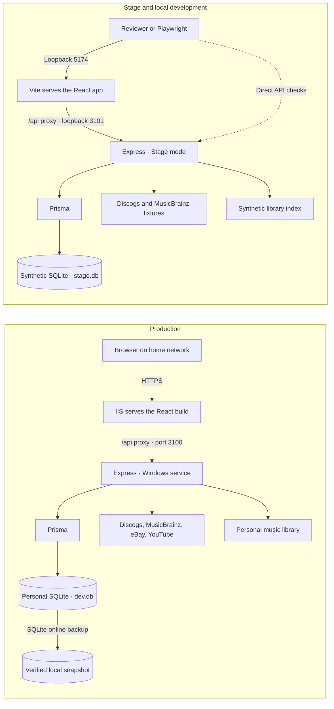
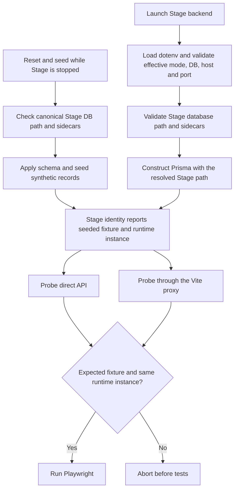
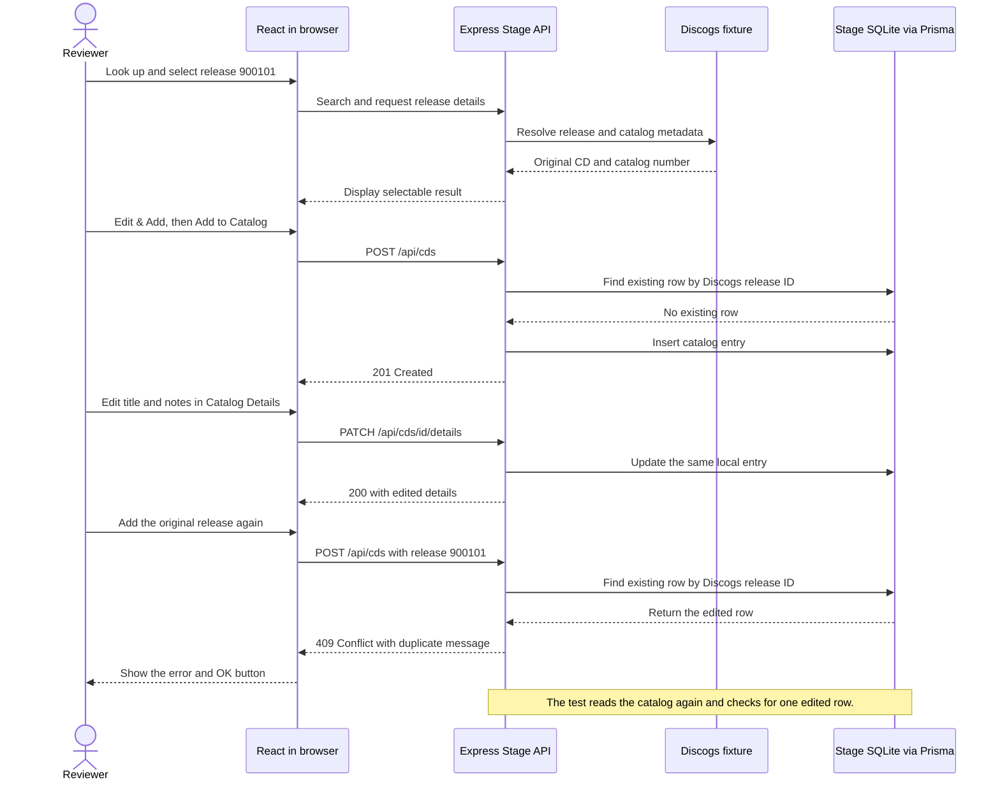

# DiscogsManager architecture

## Where to start in the code

| Area | Entry point |
| --- | --- |
| Frontend composition | [DiscogsManagerApplication.tsx](../frontend/src/DiscogsManagerApplication.tsx) wires the feature screens and their controllers. |
| Search, catalog, and library | [Frontend architecture](../frontend/src/ARCHITECTURE.md) maps the feature folders and their components, controllers, and API calls. |
| Backend startup and wiring | [backend/src/index.ts](../backend/src/index.ts) loads and validates configuration, constructs dependencies, mounts routers, and starts Express. |
| Catalog requests | [catalog-router.ts](../backend/src/routes/catalog-router.ts) owns listing, cover retrieval, adding, editing, and removing catalog entries. |
| Library and integration requests | [Music Library router](../backend/src/routes/music-library-router.ts), [release integrations router](../backend/src/routes/release-integrations-router.ts), and [Discogs sync router](../backend/src/routes/discogs-sync-router.ts) own those HTTP entry points. |
| Tests | Backend unit tests mirror source areas under `backend/tests/`. Playwright lives under `e2e/tests/` and Stage guard tests under `scripts/tests/`. |

`npm run test:unit` checks and runs the backend test sources without building `backend/dist`. The deployment entry point remains `backend/dist/index.js`. Use a clean build directory for release artifacts so older output cannot be mistaken for current files.

The startup code supplies either the live or synthetic Discogs collection client to the sync service. Both clients use the same sync workflow and database status handling. The synthetic client returns a fixture username and synthetic collection instance IDs.

## Design conventions

- **Single responsibility.** Routers parse requests and translate outcomes into HTTP responses. Services own workflows and their state. `MusicLibraryScanService` owns indexing, catalog matching, and progress. It reserves one scan slot before asynchronous validation and releases it after validation fails or the job finishes. Matching scores remain in plain functions.
- **Open/closed and substitution.** Use a shared contract when behavior needs an alternate implementation. A synthetic Discogs client follows the same contract as the live client so both can drive the same sync service.
- **Interface segregation.** Give a consumer only the operations it needs. The scan service takes a narrow subset of the Prisma client.
- **Dependency inversion.** Pass services their collaborators explicitly. Introduce an application-owned contract where it enables a real substitution, as with Discogs sync. Keep direct Prisma queries where the persistence behavior is straightforward.

`PersonalTrackMatchService` owns release track sync, single-track and album lookup, and album folder assignment and validation. Track sync and single-track lookup share candidate selection and scoring. The routes parse requests and translate outcomes into HTTP responses.

Prefer classes for workflows that own state and coordinate dependencies. Prefer plain functions for transformations and scoring. When moving behavior, preserve the HTTP and persistence contracts and verify them through the existing entry points.

## Production and Stage topology

The same React and Express code serves both environments. Stage skips live Discogs account writes and clears Discogs, eBay, and YouTube credentials. The verified production snapshot is local to the same drive. The explicit production startup guard went live in the November 18, 2026 release. See the [IIS runbook](local-iis-deployment.md) and [Stage runbook](../e2e/README.md).

## Stage checks before tests run

An unsafe database path or effective configuration stops startup before Prisma construction. Reset and seed check the path before opening or deleting SQLite files. Playwright uses the fixture and runtime identity together to check that the browser and API tests reach the same Stage application.

## Demo 1 request and data flow

The Discogs release ID identifies the pressing. The local entry ID identifies the row being edited. The demonstrated duplicate check is sequential. The schema currently has no unique constraint on Discogs release ID. See the [Demo 1 verification record](demo-one.md).
